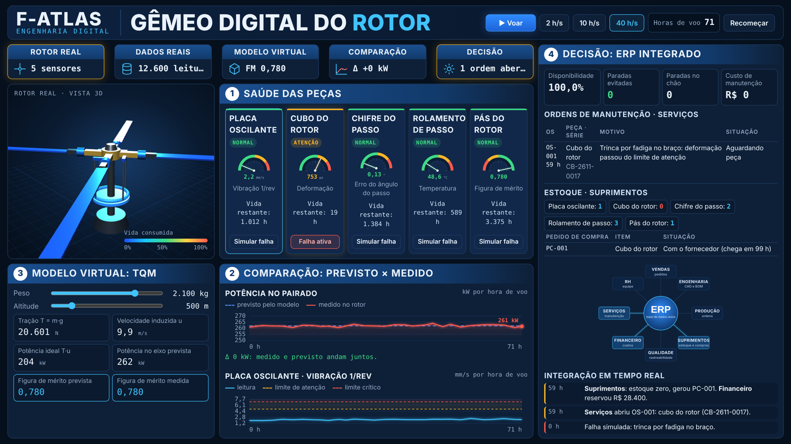

# Gêmeo Digital do Rotor de Helicóptero

**F-ATLAS Engenharia Digital** · Equipe F-ATLAS · Fatec São José dos Campos

▶ **Abrir o painel:** [f-atlas-team.github.io/rotor](https://f-atlas-team.github.io/rotor/)

## O que é

Painel de gêmeo digital das peças do rotor principal de um helicóptero leve, feito para a disciplina **Integração de Manufatura e Sistemas** (Prof. João Bandeira de Melo Netto).

O painel simula um helicóptero voando com sensores em quatro peças do rotor: placa oscilante, cubo, chifre do passo e rolamento de passo. Ele compara o que a teoria prevê com o que os sensores medem e, quando uma peça começa a se desgastar, o ERP da empresa abre a ordem de manutenção e o pedido de compra sozinho.

## Os 5 passos do gêmeo digital

| Passo | No painel |
| --- | --- |
| 1. Rotor real | Rotor em 3D; a cor de cada peça mostra a vida consumida |
| 2. Dados reais | Sensores de vibração, deformação, ângulo do passo e temperatura |
| 3. Modelo virtual | Teoria da quantidade de movimento (TQM) e figura de mérito |
| 4. Comparação | Potência prevista × medida e leitura de cada sensor com os limites |
| 5. Decisão | ERP integrado: ordens de manutenção, estoque, compras e financeiro |

## Como usar

1. Clique em **Recomeçar**.
2. No **Cubo do rotor**, clique em **Simular falha**.
3. Escolha **10 h/s** e clique em **Voar**.
4. Com cerca de 131 h de voo, o cubo entra em atenção: o ERP abre a ordem de manutenção e o pedido de compra.
5. Com 171 h, a peça chega e o voo pausa. Clique em **Executar**: a peça é trocada antes da falha.

Se não executar a troca, o cubo chega ao limite crítico com 200 h e o helicóptero fica no chão.

## Tecnologia

- HTML, CSS e JavaScript, em um único arquivo (`index.html`)
- Rotor 3D com [three.js](https://threejs.org/)
- Publicado com GitHub Pages

## Observação

Os dados dos sensores, os limites de alerta e os custos são **simulados**, para fins didáticos. A física do voo pairado segue a teoria da quantidade de movimento vista em aula.

## Equipe

André Luiz Gomes Monção · Daniel Vilhena de Oliveira · Davi Felix Ferreira Silva · Júlio Oscar E. O. Retamales

Curso Superior de Tecnologia em Manufatura Avançada · Fatec São José dos Campos · 2026
